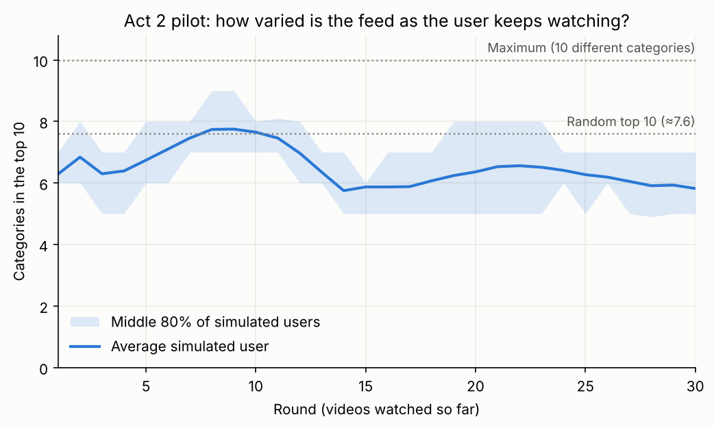

# Act 2 Pilot: Does the Feed Narrow?

**Status:** pilot done. Result: the feed does **not** narrow into the user's topic. Everyone gets a similar, popular feed. Following the rule we set before running it, we chose **option A** from [`03_act1_findings.md`](03_act1_findings.md).

---

## The short version

- **What we found:** the simulated users' feeds stay at about 6 categories out of 10 for all 30 rounds. They don't follow the topic the user started with. And different users see mostly the same videos.
- **What it means:** the "rabbit hole" in this data isn't *each user trapped in their own niche*. It's *everyone getting the same popular feed*. The usual term for this is **homogenization**.
- **Why it happens:** the model's ranking is dominated by "is this video popular with everyone?" (Act 1 findings). The user's own history barely moves the top 10.
- **What we do:** keep the watch-time metric and tell the homogenization story (option A). One more test is worth running before Act 3 (see the end).

---

## How the simulation works

A simulated user starts from one video. Each round:

1. The model scores every video in the catalogue (3,327 videos) for this user.
2. Videos already watched are removed.
3. We record the top 10 and count how many different categories it covers.
4. The user watches the #1 video and "likes" it (watch ratio 2.0, i.e. watched twice).
5. The user's taste profile is updated from everything watched so far.

Step 5 uses **fold-in**: only the user's profile is re-computed, and every video's profile stays frozen. It takes milliseconds, so the whole pilot (100 users × 30 rounds) runs in about 3 seconds.

**We checked fold-in first.** We re-computed real training users' profiles with fold-in and compared them with what the trained model learned. Correlation of the user-specific part of the scores: median **0.97**, lowest 0.80. (Correlation runs from −1 to 1; above 0.7 counts as strong, as a rule of thumb.) So fold-in is a faithful stand-in for the real model.

**The decision rule, fixed before running:**

- **Narrows** → option C: diversity drops by 2 or more categories, and users' feeds overlap less than 50% at the end.
- **Flat** → option A: diversity changes by less than 1 category, and feeds overlap 50% or more.
- Anything else: mixed, report as such.

---

## Results (100 simulated users, 30 rounds)



| What we measure | Round 1 | Round 30 | How to read it |
| --- | --- | --- | --- |
| **Categories in the top 10** (diversity) | 6.3 | 5.8 | 1 to 10, higher = more varied. A random top 10 has 7.6. The feed is a bit less varied than random, and stays flat: no collapse |
| **Share of the feed in the starting video's category** | 2.8% | 2.4% | 0% to 100%. With 38 categories, chance alone gives about 2.6%. So the feed ignores the user's starting topic completely |
| **Overlap between two users' feeds** | 95% | 65% | 0% = completely different feeds, 100% = identical. 65% means any two users share about 6.5 of their 10 videos |
| **Overlap with a brand-new user's feed** | 97% | 0% | How much the feed still looks like what a user with no history sees |

**How to read it:**

- **The feed is flat.** Diversity moves by only 0.5 categories in 30 rounds, against the 2 we said would count as "narrowing". By our rule, the verdict is **flat**.
- **Users move away from the starting list, but together.** By round 30, nobody's feed looks like a new user's (0% overlap). But any two users still share 65% of their feed. Everyone is walking down the *same* list of popular videos, in slightly different orders.
- **Where the watched videos come from:** the median watched video ranks **15th out of 3,327** in the overall popularity ranking. Users are watching the top 1% of the catalogue.
- **Only 59 different videos** appear across all 30,000 recommendation slots (100 users × 30 rounds × 10 slots).

**Why it happens.** The Act 1 findings showed that "which video it is" matters 6 times more than "who is watching" (30% vs 5% of the differences between views). In the simulation, each user watches what's popular, the profile learns "likes popular videos", and the next recommendations are popular again. It's a feedback loop, but toward **the global top list**, not toward a personal topic.

---

## What this changes for the project

**The story (option A):** "A recommender that only optimizes watch time doesn't give each user a personal rabbit hole. It gives everyone the same short, popular clips." That's still the project's research question (*what happens when you optimize only for watch time?*), with a more surprising answer.

**Act 3 needs a second diversity measure.** "Categories in the top 10" alone misses the main problem, since each feed has about 6 categories. What's missing is **variety between users**. We propose tracking both in Act 3:

- categories in the top 10 (variety *within* one feed), and
- overlap between users' feeds (variety *across* the platform; lower = healthier).

The re-ranker (MMR) can then be judged on whether it makes feeds *different from each other*, not just more mixed.

---

## Limitation, and one more test worth running

**Our simulated user likes whatever is #1.** It never says "I prefer cooking", so it can't pull the feed toward a topic. Real users do. That makes the pilot a fair test of the plan's design, but it can't rule out that a **topic-loyal user** would get a topic feed.

**Proposed next test (quick, same code):** a user who only "likes" videos from their starting category and skips the rest (low watch ratio). Two possible results:

- **The feed still doesn't follow the topic:** homogenization is robust, and the story gets stronger.
- **The feed does follow the topic:** there *is* a rabbit hole, but only for users with a strong taste. That's worth a slide of its own.

---

## How to reproduce

```
python src/model.py fit       # trains the final model, about 10 seconds
python src/simulate.py        # the pilot, about 3 seconds
```

Outputs: `results/act2_summary.json`, `results/act2_rounds.csv`, `results/figures/02_diversity_over_rounds.png`.
