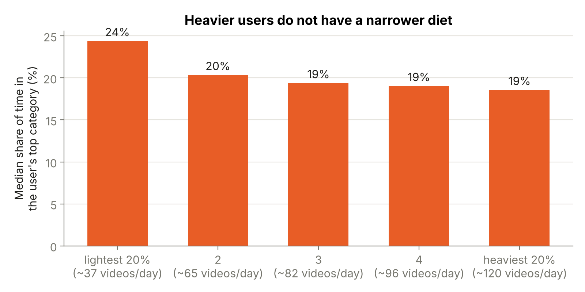

# Part 4: The Video Nutrition Label

**Author:** Imad eddine Djehlane

## In one paragraph

Food comes with an ingredient label. Short video does not. We built a prototype "video nutrition label" that turns a user's viewing log into a one-glance summary: how many videos a day, what the time is made of (categories as "ingredients"), how much of it is replays, how much happens at night, and the longest stretch without a break. A language model then writes a three-sentence summary in plain words. We ran the label on 5,765 real Kuaishou users from the KuaiRec dataset. The prototype works and is easy to read. The data also shows its limits: KuaiRec records only part of what people watch, so the label can be trusted on counts and shares, but not on minutes.

## 1. Why a label

Part 1 showed that short-video feeds are optimised for watch time and are designed so users lose track of time ("no clocks in the casino"). Part 3 showed that the law (DSA, GDPR, AI Act) asks platforms to explain *how* the recommender works, but nobody shows users *what they actually consumed*. A nutrition label closes that gap. It does not block or judge anything. It puts the clock back and lets the user decide.

## 2. What the label shows

One label = one user, "serving size" = one average day over the 28 logging days in the data.

| Line on the label | What it measures | How to read it |
| --- | --- | --- |
| **Videos per day** | Logged videos watched per active day | The main "calories" line. A count, so it is reliable even though the data is incomplete (see section 5) |
| **Ingredients** | Share of watch time per category (top 5 + "Other") | 39% Local news = about 4 of every 10 seconds watched were local news |
| **Variety** | How many of the 39 categories it takes to reach 80% of the user's time | 0 to 39, higher = more varied |
| **Replays** ("added sugar") | Seconds watched beyond one full play of a video, as a share of all watch time | A 10-second clip watched for 25 seconds adds 15 replay seconds |
| **Night viewing** | Share of watch time between 00:00 and 05:59 | Uses the clock stored in the data (see the caveat in section 5) |
| **Quick swipes** | Share of videos left before a quarter was watched | High = a lot of searching for the next hit |
| **Longest sitting** | Most videos watched with no 30-minute break | The 30-minute rule is a common convention in web analytics, not a health limit |

**There is no official "healthy amount" of short video**, so the label has no "% Daily Value" like a food label. Instead, every line says how the user compares with the other 5,765 users ("higher than 93% of users"). This is a comparison, not a target.

**The AI summary.** A language model receives only the numbers on the label, never the raw watch history. The prompt asks for exactly three sentences: what the viewing is mostly made of, the one thing that stands out compared with other users, and one optional suggestion phrased as a choice. It must use only the numbers it was given, make no medical claims, and not moralise. Example (user 4701):

> "About 39% of your viewing time goes to Local news, followed by Celebrities (6%) and Parenting (5%). What stands out most is how much one topic leads: your top category takes a bigger share of your time than for 97% of users. If you like, you could follow one or two new topics this week and see whether your mix changes."

The three demo summaries in the prototype were written by Claude (Anthropic) with this prompt while building the prototype. The notebook can regenerate them, and summaries for any other user, with Google Gemini's free tier (the same set-up Role 3 used). Without an API key the prototype falls back to a rule-based text and says so on screen.

## 3. Data and method

- **Data:** KuaiRec `big_matrix.csv` (Gao et al., 2022). One row = one user watched one video once, with the time watched, the video length and a timestamp. 12.5 million views, 7,176 users, 10,728 videos, 28 logging days between July and September 2020. Each video has one category from `kuairec_caption_category.csv` (39 first-level categories, translated into English).
- **Why `big_matrix` and not `small_matrix`:** the label describes what people chose to watch in their normal feed. The big matrix is that natural viewing. The small matrix is the test set, where videos were shown to users so that every user sees every video. That is ideal for testing a recommender (Roles 2 and 3), but it is not natural viewing.
- **Reference group: 5,765 users.** We left out the 1,411 test-set users from all comparisons (see finding 1).
- **Demo users were picked by a fixed rule, not by hand.** Among users with a typical amount of viewing (40th to 60th percentile of videos per day), we took the one with the narrowest mix (user 4701) and the broadest mix (user 3452), plus the user at the 95th percentile of videos per day (user 4102).
- **Tools:** Python (pandas, matplotlib). One script builds every number, chart and the prototype. It runs in about 2 minutes on a laptop or in Google Colab.

## 4. Findings

### Finding 1: The 100 users shared with Roles 2 and 3 can't get a fair label

**What we found.** The 1,411 test-set users look like very light viewers in the training data: a median of **15 videos a day**, against **82** for everyone else. Their longest sitting is a median of **14 videos**, against **200**. The heaviest of the 100 shared users watches only 23 videos a day, which is lighter than 95% of the other users.

**What it means.** A label for these users would be wrong: it would call them light viewers when we simply can't see part of their viewing. So the label's comparisons use only the other 5,765 users. The shared users are still in the prototype (to connect with the AI agent demo), with a warning on screen.

**Why it happens.** KuaiRec's authors moved these users' views of the 3,327 test-set videos out of the big matrix, so that the test set stays clean. That is the right choice for evaluating recommenders, but it leaves a hole in these users' history.

**What we should do.** Nothing changes for Roles 2 and 3: training on the big matrix and testing on the small matrix is exactly what the dataset is built for. For the label, we keep the 5,765 users with complete histories as the reference group and mention it in the presentation if asked.

### Finding 2: The data records only part of the viewing, so the label counts videos, not minutes

**What we found.** Inside a sitting, the logged watch time is only about **4%** of the time between the first and the last logged video. A typical gap between two logged videos is almost **2 minutes**, while a typical logged video is watched for about **7 seconds**.

**What it means.** The minutes on the label (median user: **12 minutes a day**) are far below real usage and should not be quoted as "time spent". Video counts, category shares and comparisons between users are what the label relies on.

**Why it happens.** KuaiRec contains 10,728 videos, not the whole Kuaishou catalogue. Everything else the users watched in between is not in the file.

**What we tried and rejected.** We estimated "time in the app" from the length of each sitting. It gave a median of **4.3 hours a day** and one "sitting" of **32 hours**, because any pause under 30 minutes counts as time in the app. Those numbers aren't credible, so the label doesn't use them. On a real platform this problem disappears: the platform (or a user's own data download) has every video.

### Finding 3: More than a quarter of all watch time is replays

**What we found.** **28%** of all watch time is replays: seconds watched after the video had already played once in full. The median user is at **26%** (10% of users are below 10%, 10% are above 46%). It varies by category: Local news is the most replayed of the big categories (**33%** of its time), and Food the least (**21%**).

**What it means.** This is the label's "added sugar" line. A large part of the time is not spent on new content but on loops, which short-video apps start automatically when a clip ends. User 4701 (the "narrow diet") spends **49%** of their time on replays, more than 93% of users.

**Why it happens.** Most clips are short (median length about 10 seconds) and loop automatically. Whether a replay is a choice or just not swiping away can't be told from the data. That is a guess we can't test here.

**What we should do.** Keep the line, and name it neutrally ("Replays") on the label itself. "Added sugar" is our metaphor for the presentation.

### Finding 4: Heavier users do not have a narrower diet

**What we found.** Users who watch more videos do not concentrate on fewer topics. The link between videos per day and the top category's share is weak and slightly negative (**Spearman correlation −0.24**, on a scale from −1 to +1 where 0 = no link). The lightest 20% of users (about 37 videos a day) spend **24%** of their time on their top category; the heaviest 20% (about 120 a day) spend **19%**. For comparison, a user who watched exactly the platform-wide mix would have **20%** in their top category (Local news). Heavier users do replay less (correlation −0.55) and swipe away less (−0.53), and watch more at night (**21%** of their time for the heaviest 20%, **9%** for the lightest 20%; correlation +0.19, weak).

**What it means.** In this data, the "rabbit hole" is not visible as a narrowing of topics. Heavy use shows up as *more of everything*, longer sittings and more night viewing. For the label, it means the most useful lines for heavy users are volume, sitting length and night viewing. The variety line matters most for the few narrow users like 4701.

**Why it happens.** We can only guess. Two candidate reasons: KuaiRec's video sample is spread over many categories, and heavy users may simply accept whatever the feed shows rather than searching for one topic. The data can't separate the two.

### Finding 5: Some "ingredients" are mostly spat out

**What we found.** For most categories, about **15–25%** of videos are left before a quarter was watched. A few are far higher: Finance **77%**, Short drama **55%**, Tech & gadgets **50%**, Film & TV **49%**, Health **45%**, Food **44%**.

**What it means.** These categories are shown often but rejected quickly. On a label, a high "quick swipes" line tells the user that a lot of their scrolling is searching rather than watching.

## 5. Limits

- **Incomplete viewing log** (finding 2): minutes are understated. The method is the point; on real platform data the same label works with real minutes.
- **The clock.** Viewing in the data peaks at 10:00 and is lowest at 23:00, an unusual pattern for an entertainment app. We could not confirm the time zone of the stored clock, so the night line is illustrative.
- **Categories are the platform's own.** "Other topics" and "Local news" are broad buckets. A real label might need finer topics, which an AI model could tag from the video titles.
- **Offline, 2020, one platform, no user feedback.** We did not test whether people find the label useful or change their behaviour. That would need a user study.
- **Comparisons are relative.** "Higher than 90% of users" says nothing about whether that amount is harmful. No accepted threshold exists, and we did not invent one.

## 6. How it would work in practice

The label only helps if it appears at the right moment. We propose three:

1. **While scrolling:** a small, always-visible counter ("76 videos today, mostly Local news"). Nothing is blocked; the clock is simply back.
2. **At your limit:** when a limit the *user* chose is reached, the feed pauses and shows what the sitting was made of. One tap continues.
3. **Next morning:** the full label with the AI summary, once a day, when the user isn't in the feed.

**Who can build it.** The platform could build all three tomorrow, because it already has every number. A third party (a browser plug-in or an independent app) can do less:

| | Platform | Third party |
| --- | --- | --- |
| 01 · while scrolling | Yes | Only on the web version, via a browser plug-in. Mobile apps can't read another app's screen |
| 02 · at your limit | Yes | Partly: phone settings (Screen Time, Digital Wellbeing) can cap total app time, but can't say what the time was made of |
| 03 · next morning | Yes | Yes, with a delay: the user can download their own watch history (GDPR right of access, Art. 15; data portability, Art. 20). The export has no categories, so an AI model would have to tag the videos |
| Change the feed itself | Yes | No |

**What this means:** a third-party label is possible today for moment 3, and that's the realistic first product. Moments 1 and 2 on mobile need the platform, and that's where regulation (the DSA's transparency duties, the planned Digital Fairness Act) could push.

## 7. Files

- `01_label_prototype.html`: the clickable prototype (open in any browser).
- `02_slides/`: slides 21 and 22 for the team deck, plus an optional backup slide.
- `04_notebook_video_nutrition_label.ipynb`: the full analysis; runs in Google Colab.
- `06_results/`: all numbers (CSV/JSON) and charts.

## References

- Gao, C., Li, S., Lei, W., Chen, J., Li, B., Jiang, P., He, X., Mao, J., & Chua, T.-S. (2022). KuaiRec: A Fully-Observed Dataset and Insights for Evaluating Recommender Systems. *CIKM '22*.
- Regulation (EU) 2016/679 (General Data Protection Regulation), Art. 15 and Art. 20.
- Regulation (EU) 2022/2065 (Digital Services Act), Art. 27 and Art. 38.
